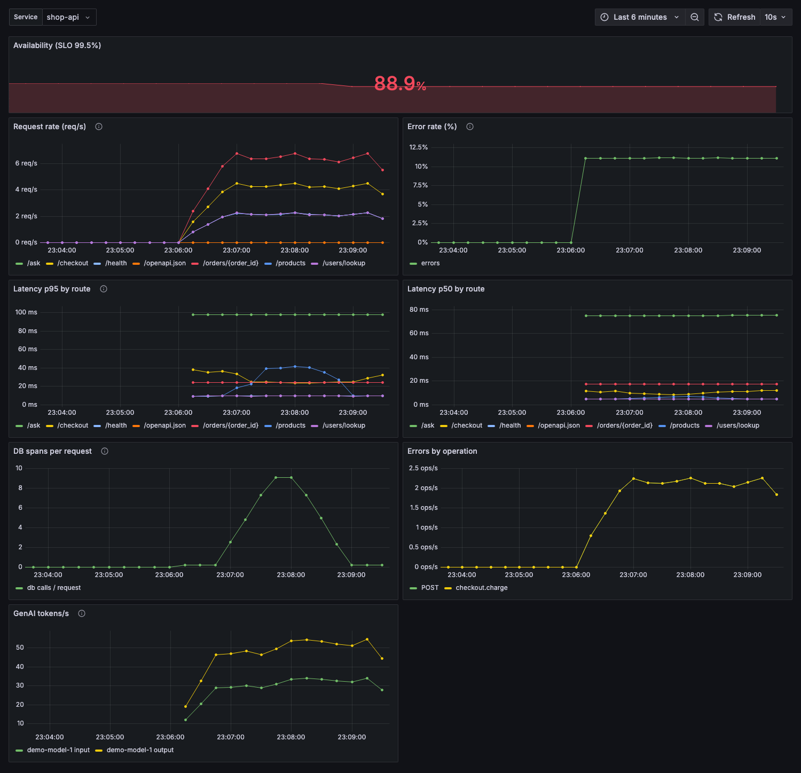
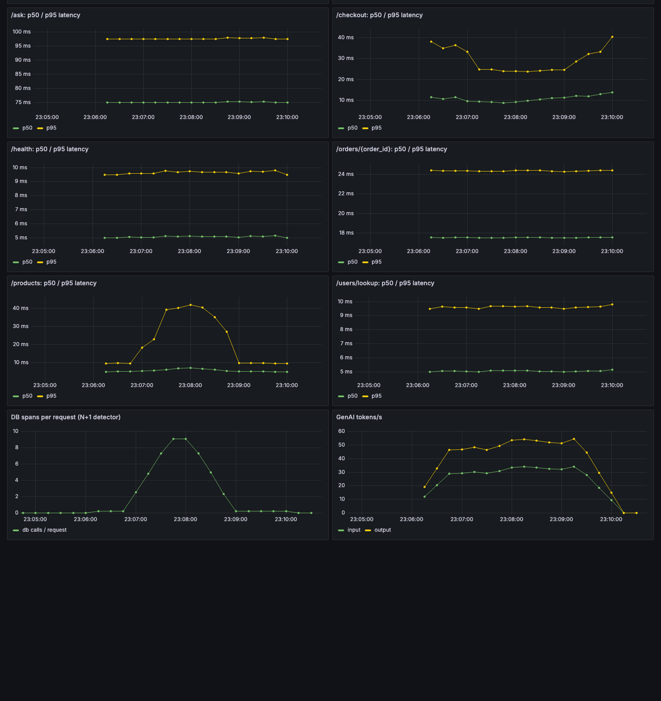

# otel-autopilot

**Point an AI agent at a messy service. Get verified OpenTelemetry instrumentation and standard dashboards, with a score that proves it works.**

Vendor-neutral (plain OTLP, Grafana stack), reproducible, and measurable: the AI's work is checked by running the service, not by trusting the diff.

```text
$ autopilot verify shop-api            $ autopilot verify shop-api
BEFORE                                 AFTER (agent-instrumented)
Instrumentation score: 0/100           Instrumentation score: 100/100
  FAIL  Any spans reach the collector    PASS  Server span with http.route for every endpoint
        0 spans received                 PASS  Failures recorded (ERROR + exception)
                                         PASS  No PII or secrets in span attributes
                                         PASS  LLM calls carry GenAI attributes + token usage
```



*The standard dashboard (shared library panels, `$service` variable). Note "DB spans per request": traces exposed an N+1 query, and the fix is visible as the drop.*

## Why this and not a vendor tool
- **Vendor-neutral:** emits OTLP, works with any backend.
- **Verified:** a verifier runs the app with traffic and scores what actually arrives. Catches real problems (we found sqlite `connection.execute()` is silently untraced).
- **Standard metrics:** 7 shared Grafana library panels, fixed once and updated everywhere, plus one-off dashboards generated from what a service emits.
- **Measurable:** an eval harness runs the agent N times to give a first-pass success rate.

## Run the demo
Needs Python 3.10+, [uv](https://docs.astral.sh/uv/), Docker, and the `claude` CLI for agent mode. Free ports: 3000, 3200, 4317, 4318, 8000, 8001, 8889, 9090.

```bash
uv sync
demo/demo.sh replay          # deterministic: applies the reference solution
demo/demo.sh agent           # live: Claude Code instruments the service
DEMO_PAUSE=1 demo/demo.sh    # pause between steps while presenting
docker compose down          # stop the backend afterwards
```
Grafana: http://localhost:3000 (anonymous admin, local only).

## What the demo does

| Step | What happens | What the audience sees |
|---|---|---|
| 0 | Fresh copy of `sample-app/messy` | No telemetry, swallowed errors, N+1 queries, string-built SQL |
| 1 | `autopilot verify` | **0/100**, "0 spans received" |
| 2 | Agent follows `skills/otel-instrument` (or replay applies the reference) | A diff plus `instrumentation-plan.md` |
| 3 | `autopilot verify` again | **100/100** with a per-check report |
| 4 | `docker compose up`, `autopilot load` | Data flowing into Tempo and Prometheus |
| 5 | `autopilot dash standard / oneoff / push` | Standard and tailored dashboards in Grafana |
| 6 | N+1 replaced with a join | DB spans per request drops from ~15 to ~0.3 |

Only step 2 in agent mode calls an LLM. Everything else is local.



*A one-off dashboard generated from discovered routes, DB and GenAI usage.*

## How it fits together


Detailed diagrams, the list of pieces and the verifier's checks: [docs/architecture.md](docs/architecture.md).

## Is it reproducible?

| Part | Reproducible? |
|---|---|
| `demo.sh replay` | Yes. Same code, traffic and pinned images give the same story and score. Exact span counts vary slightly |
| `demo.sh agent` | The pipeline is, the LLM's edits are not identical run to run. One observed run reached 100/100. Run `demo/eval.sh 5` for a real success rate before quoting one |
| Backend and dashboards | Yes. Idempotent pushes, pinned images |
| Offline | First run needs network for images and packages. Replay needs no LLM access |

Tested on macOS with Colima and Python 3.11. Not tested on Linux, Windows or Docker Desktop.

## Reuse vs build
Reused: OpenTelemetry instrumentations, Grafana, Collector `spanmetrics`, Grafana's official `mcp-grafana`. Existing vendor OTel skills (Dash0, Elastic, Honeycomb and others) are good references.
Built here: the verifier and score, the thin distro, standard-panel templating, the eval harness.

## Honest limits
- Toy app (SQLite, one service). It proves the approach, not scale. The real test is a client pilot.
- The verifier checks telemetry *shape*, not whether the business-span choices are the right ones.
- Python and FastAPI only. Logs (Loki) are not wired yet.
- The availability stat in the screenshot is red on purpose: the traffic profile includes failing checkouts to demonstrate error recording.
