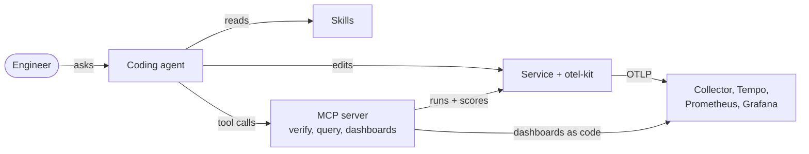

# otel-autopilot

**Point an AI agent at a messy service. Get verified OpenTelemetry instrumentation and standard dashboards, with a score that proves it works.**

Vendor-neutral (plain OTLP, Grafana stack), reproducible, and measurable: the AI's work is checked by running the service, not by trusting the diff.

```text
$ uv run autopilot verify <service dir>

BEFORE: sample-app/messy                AFTER: sample-app/reference
Instrumentation score: 0/100            Instrumentation score: 100/100
  FAIL  Any spans reach the collector     PASS  Server span with http.route for every endpoint
        0 spans received                  PASS  Failures recorded (ERROR + exception)
                                          PASS  No PII or secrets in span attributes
                                          PASS  LLM calls carry GenAI attributes + token usage
```


*The standard dashboard (shared library panels, `$service` variable). "DB spans per request" shows an N+1 query that the traces exposed, and the drop after the fix.*

## Why this and not a vendor tool
- **Vendor-neutral:** emits OTLP, works with any backend.
- **Verified:** a verifier runs the app with traffic and scores what actually arrives. It catches real problems (we found sqlite `connection.execute()` is silently untraced).
- **Standard metrics:** 7 shared Grafana library panels, fixed once and updated everywhere, plus one-off dashboards generated from what a service emits.
- **Measurable:** an eval harness runs the agent N times to give a first-pass success rate.

---

## Quick start

Needs Python 3.10+, [uv](https://docs.astral.sh/uv/), and Docker running (Docker Desktop, or `colima start`). Agent mode also needs the `claude` CLI.
Free ports: 3000, 3200, 4317, 4318, 8000, 8001, 8889, 9090.

```bash
git clone <this repo> && cd otel-autopilot
uv sync                              # install everything into .venv (first time only)
demo/demo.sh replay                  # the whole demo, deterministic, no AI (~80s)
```

The demo opens Grafana for you. Everything else is below.

## Every command

`autopilot` is installed inside the project's virtualenv, so it is always run as **`uv run autopilot ...`** (or `source .venv/bin/activate` once, then plain `autopilot`). It takes a **path to a service directory**, not a name.

| Goal | Command |
|---|---|
| Install | `uv sync` |
| Run the full demo, no AI | `demo/demo.sh replay` |
| Run the full demo, live AI | `demo/demo.sh agent` |
| Pause between steps (presenting) | `DEMO_PAUSE=1 demo/demo.sh replay` |
| Don't auto-open the browser | `DEMO_NO_OPEN=1 demo/demo.sh replay` |
| Preflight only (uv, Docker, ports) | `demo/demo.sh setup` |
| Re-open the Grafana dashboards | `demo/demo.sh open` |
| Reset between runs | `demo/demo.sh reset` |
| Reset including clean Grafana graphs | `demo/demo.sh reset --full` |
| Stop the backend | `demo/demo.sh down` |
| Score a service by hand | `uv run autopilot verify sample-app/messy` (0/100), `uv run autopilot verify sample-app/reference` (100/100) |
| Use the score as a CI gate | `uv run autopilot verify <dir> --min-score 90` (exit 1 below 90) |
| Machine-readable report | `uv run autopilot verify <dir> --json` |
| Send traffic to the real collector | `uv run autopilot load <dir> --seconds 60` |
| Generate / push dashboards | `uv run autopilot dash standard`, `dash oneoff --service shop-api`, `dash push --out <dir>` |
| Run the agent N times, report success rate | `demo/eval.sh 5` (costs LLM tokens) |
| Start the MCP server by hand | `uv run autopilot-mcp` |

## What the demo does (8 steps)

The script prints `[n/8]`, what the step shows, and every command it runs.

| # | Step | What you see |
|---|---|---|
| 1 | **Preflight** | `uv sync`, Docker running, ports free |
| 2 | **Reset** | Fresh copy of the messy service in `demo/workspace/shop-api` (originals in `sample-app/` are never touched) |
| 3 | **BEFORE** | `autopilot verify` starts the service, sends traffic, scores telemetry: **0/100** |
| 4 | **AI instruments it** | A diff of `app.py`, plus `instrumentation-plan.md` explaining each decision. In agent mode you also watch Claude work live |
| 5 | **AFTER** | Same verifier, same traffic: **100/100** with a PASS/FAIL line per check |
| 6 | **Real backend** | Docker starts Collector, Tempo, Prometheus, Grafana; 30s of traffic with a progress bar |
| 7 | **Dashboards as code** | Standard and one-off dashboards generated and pushed; the script prints the URLs and opens your browser |
| 8 | **Payoff** | Traces exposed an N+1 query (~15 DB calls per request). The script swaps in a one-query fix (~0.3) and sends more traffic. Watch the panel drop |

## Replay vs agent: what's the difference?

| | `replay` | `agent` |
|---|---|---|
| Who writes the instrumentation | **Nobody.** It copies a pre-written solution (`sample-app/reference/app.py`) over the messy file | **Claude Code**, live, following the skills |
| Is anything "figured out"? | No. It is a recording of what the agent produces. It shows the pipeline (verify, backend, dashboards), not the AI | Yes. The agent reads the code, finds the problems, edits, checks itself with the verifier, iterates |
| Deterministic? | Yes (same code, same score) | No. Edits differ run to run. The *verifier* is what makes the result trustworthy |
| Cost / time | Free, ~80s | ~2-3 min extra, roughly $0.40 in LLM usage |
| Use it for | Rehearsing, recording a video, a reliable live demo | Showing the real thing |

Be upfront about this when presenting: replay is a recording; agent is live.

## How the agent part works

1. **Claude access.** `demo.sh agent` runs your locally installed `claude` CLI in headless mode (`claude -p "<prompt>"`) inside `demo/workspace/shop-api`. It uses whatever login or API key you already have; nothing else is needed. Flags isolate the run from your personal setup (`--setting-sources project`, `--strict-mcp-config`) and limit which tools it may use.
2. **Skills.** A skill is a folder with a `SKILL.md` (a name, a one-line description, and instructions). The demo copies `skills/` into `demo/workspace/shop-api/.claude/skills/`, where Claude Code discovers them automatically. The agent sees each skill's name and description, loads the full `SKILL.md` when the task matches (you see `skill  loading skill 'otel-instrument'` in the output), and follows it: discover, baseline, instrument, verify, write the plan. The skills include explicit "stop and ask a human" rules and known gotchas.
3. **MCP server.** `demo.sh` writes `demo/workspace/shop-api/.mcp.json` so Claude launches our MCP server (`autopilot-mcp`) as a subprocess. The agent calls `verify_instrumentation` through it to score its own work. The server also offers `query_prometheus`, `search_traces` and `generate_dashboards`.
4. **The wrapper library.** Yes, `otel-kit` is involved. The instrumented code calls `otelkit.init("shop-api", app=app)`, plus `otelkit.business_span(...)` and `otelkit.genai_call(...)`. See "Custom pieces" below for what it does and deliberately doesn't do.

What you see in agent mode: `setup` (skills loaded, MCP status), `skill`, `read`/`edit`/`write` (files touched), `run` (shell commands), `mcp` (tool calls), `verify` (score after each check), `claude` (its reasoning), then turns, seconds and cost.

## Custom pieces vs reused pieces

**Built here (custom):**

| Piece | Path | What it is |
|---|---|---|
| Skills | `skills/` | Plain-markdown procedures for any coding agent: `otel-instrument`, `otel-verify`, `otel-dashboards` |
| Verifier | `autopilot/` (`autopilot verify`) | Runs the service with traffic, receives its telemetry over OTLP, runs 10 checks, gives a 0-100 score and fix hints. Usable as a CI gate |
| MCP server | `autopilot/` (`autopilot-mcp`) | Lets an agent verify its work, query Prometheus/Tempo, generate dashboards |
| Thin OTel library | `otel-kit/` | One `init()` that sets resource attributes (service name, version, env), OTLP export, PII/secret scrubbing, and enables FastAPI/httpx/sqlite3 auto-instrumentation. Helpers for business spans and GenAI calls (OTel GenAI conventions). It does **not** wrap or hide the OpenTelemetry API: custom code uses `opentelemetry.trace` directly, so there is no lock-in |
| Dashboard generator | `autopilot/` (`autopilot dash`) | 7 shared Grafana library panels plus a `$service` dashboard, and one-off dashboards discovered from what a service emits |
| Demo harness | `demo/` | `demo.sh`, `stream.py` (live agent view), `eval.sh` (agent success-rate harness) |
| Sample service | `sample-app/` | A messy FastAPI app (no telemetry, swallowed errors, N+1 queries, raw SQL), a reference solution, and the N+1 fix |

**Reused (not ours):** OpenTelemetry SDK and instrumentations, OTel Collector (`spanmetrics`), Tempo, Prometheus, Grafana, Claude Code, and Grafana's official `mcp-grafana` (registered in `.mcp.json`). Existing vendor OTel skills (Dash0, Elastic, Honeycomb and others) are good references; ours add verification, scoring and the eval loop.

Detailed diagrams and the list of checks: [docs/architecture.md](docs/architecture.md).



## Where to look (Grafana and the rest)

The backend runs in Docker on your machine, with no login. After step 7 the script prints these and opens them in your browser:

| What | Where |
|---|---|
| Standard dashboard | http://localhost:3000/d/otel-standard-red/service-overview-standard?var-service=shop-api |
| One-off dashboard | http://localhost:3000/d/otel-oneoff-shop-api/shop-api-generated |
| All dashboards | http://localhost:3000, then Dashboards, filter by tag `otel-autopilot` |
| Individual traces | http://localhost:3000/explore, pick **Tempo**, Search, `service.name = shop-api` |
| Raw metrics | http://localhost:9090 (Prometheus), e.g. `traces_span_metrics_calls_total` |
| What the AI changed | `demo/workspace/shop-api/app.py` and `instrumentation-plan.md` |
| Dashboards as code | `dashboards/out/` and `dashboards/out-oneoff/` |

**What to point at:** "DB spans per request" (the N+1 and the fix), `/products` p95 latency, "Errors by operation" (the failing payments the old code swallowed), "GenAI tokens/s", and the availability stat. That stat is red on purpose: the traffic includes failing checkouts to show error recording works.
Dashboards show the last 15 minutes and refresh every 10s, so run a demo fresh (see below).

## Setting up and resetting a demo run

- **Set up:** `uv sync`, start Docker, `demo/demo.sh setup` (checks everything).
- **Run:** `demo/demo.sh replay` or `demo/demo.sh agent`. Each run resets the workspace itself first.
- **Reset between runs:** `demo/demo.sh reset` removes `demo/workspace` and kills leftover servers on 8000/8001 (only our own uvicorn processes).
- **Clean graphs for a recorded take:** `demo/demo.sh reset --full` also wipes the backend so Grafana starts empty.
- **Done for the day:** `demo/demo.sh down`.

## Troubleshooting

| Symptom | Fix |
|---|---|
| `autopilot: command not found` | Use `uv run autopilot ...` |
| `Docker is not running` | Start Docker Desktop, or `colima start` |
| `port 8000 is in use` | `demo/demo.sh reset` |
| `Connection refused` on 4318 / 9090 / 3000 | The backend isn't up: `docker compose up -d`, or rerun the demo (it waits for each service) |
| `Transient error ... retrying` lines | Harmless: an app retrying export while the collector isn't ready |
| Agent step fails to start Claude | Check `claude --version` and that you're logged in |
| Elapsed time or traffic looks wrong | If the laptop sleeps mid-demo, clocks and progress bars jump. Keep it awake (`caffeinate -i demo/demo.sh replay`) |

## Is it reproducible?

| Part | Reproducible? |
|---|---|
| `replay` | Yes. Same code, traffic and pinned images give the same story and score. Exact span counts vary slightly |
| `agent` | The pipeline is; the AI's edits are not identical run to run. Three live runs so far all reached 100/100 (about 24-30 turns, $0.38-0.52 each). Run `demo/eval.sh 5` for a real success rate before quoting one |
| Backend and dashboards | Yes. Pinned images, idempotent pushes |
| Offline | First run needs network (images, packages). Replay needs no LLM access |

Tested on macOS with Colima and Python 3.11. Not tested on Linux, Windows or Docker Desktop.

## Honest limits
- Toy app (SQLite, one service). It proves the approach, not scale. The real test is a client pilot.
- The verifier checks telemetry *shape*, not whether the business-span choices are the right ones.
- Python and FastAPI only. Logs (Loki) are not wired yet.
- The agent sometimes wanders (it searched the disk for the library before finding it). The verifier, not the transcript, is the source of truth.
