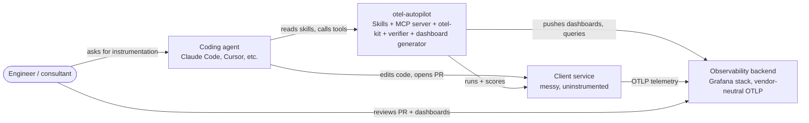
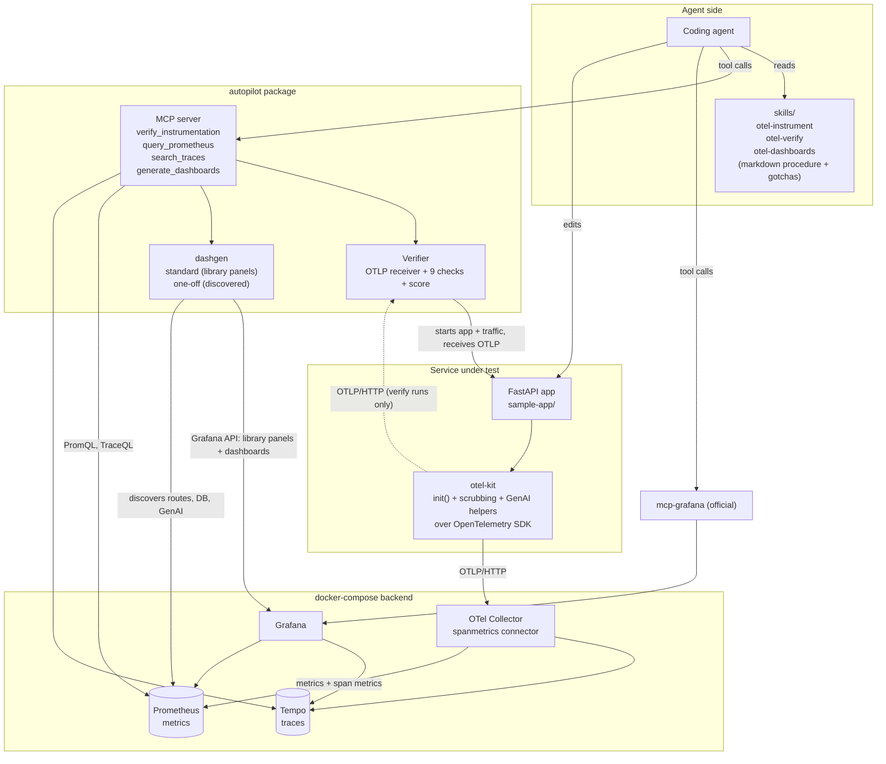
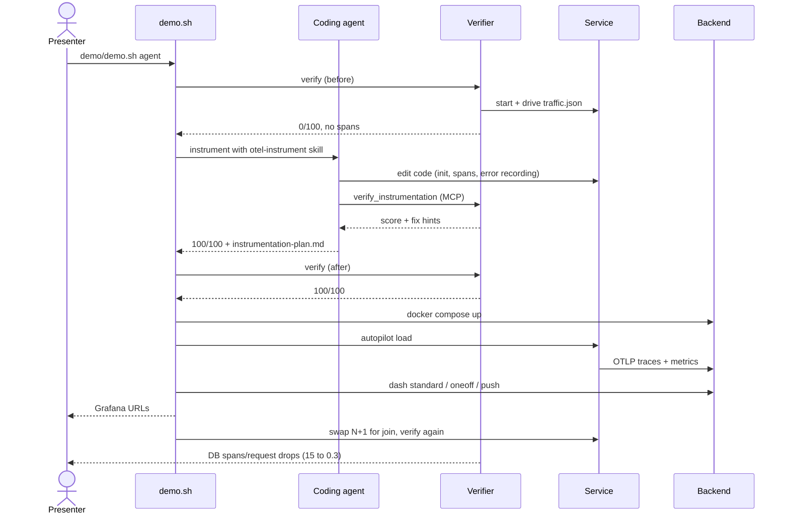

# Architecture

Detail behind the [README](../README.md).

### System context (C4 level 1)

### Containers (C4 level 2)

## One demo run (sequence)

## Pieces

| Path | What it is |
|---|---|
| `skills/` | Vendor-neutral agent skills in plain markdown: discover, instrument, verify, dashboards. Include gotchas and "stop and ask a human" rules |
| `autopilot/` | `autopilot verify` (receiver, checks, score, CI gate via `--min-score`), `autopilot load`, `autopilot dash`, and the MCP server |
| `otel-kit/` | Thin, config-only distro: one `init()`, PII/secret scrubbing, GenAI and business-span helpers. Does not wrap the OTel API |
| `sample-app/` | `messy/` (the input), `reference/` (the target), `reference-fixed/` (N+1 fixed), `traffic.json` |
| `stack/`, `docker-compose.yml` | Collector with span metrics, Tempo, Prometheus, Grafana (images pinned) |
| `.mcp.json` | Registers our MCP server and Grafana's official `mcp-grafana` |
| `demo/demo.sh`, `demo/eval.sh` | The demo; and an eval harness that runs the agent N times and reports first-pass success |
| `dashboards/` | Generated dashboard JSON, committed so changes are reviewable |

### What the verifier checks (weights sum to 100)
Spans arrive (5), `service.name` (10), version and environment (5), a SERVER span with `http.route` for every endpoint (15), route-template span names (10), DB spans (10), outbound HTTP linked to the request trace (10), failures recorded as ERROR plus exception (15), no PII or secrets in attributes (10), GenAI attributes and token usage (10).

## Design notes
- **MCP vs skills:** skills carry procedure and knowledge (portable markdown). MCP covers live actions: verifying, confirming data landed, dashboards. Code edits stay with the agent's own file tools.
- **Thin distro:** `otel-kit` is config-only plus helpers. It never wraps the OTel API, so there is no lock-in and no key-person risk.
- **Dashboards:** library panels can only be created via the Grafana API, not file provisioning, so `autopilot dash push` uses the API and updates panels in place.
- **Verifier receiver:** an in-process OTLP/HTTP receiver, so verification needs no Docker and can run in CI.
